<div align="center">

# Legacy Mind

### A Flask AI personal assistant — ask anything, summarise any email — powered by Groq-hosted GPT-OSS 120B


</div>

---

## Demo

The interface is a single glassmorphism card over an animated galaxy background, with two tools: **Ask Anything** and **Summarise Email**.

### Ask Anything

Single-turn Q&A. Below, the question *"what is ai"* returns a structured answer from GPT-OSS 120B.

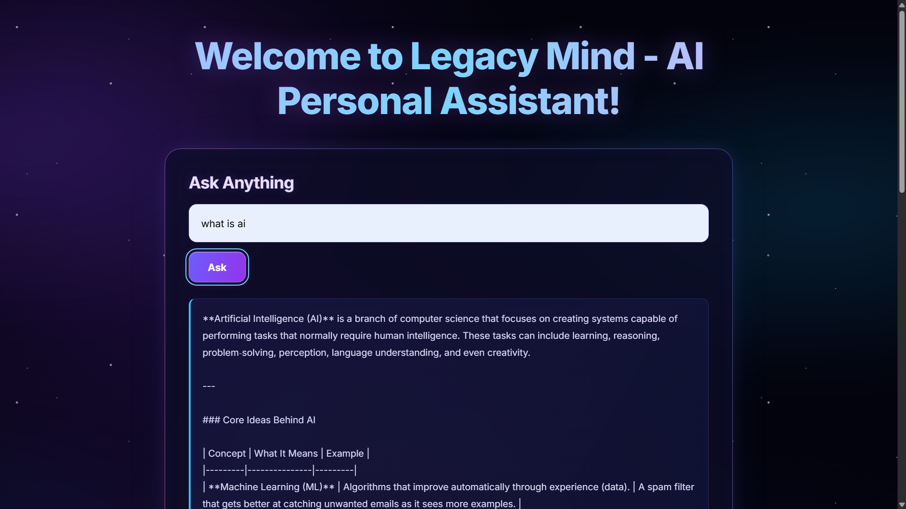

The answer continues below the fold (scrolled view):

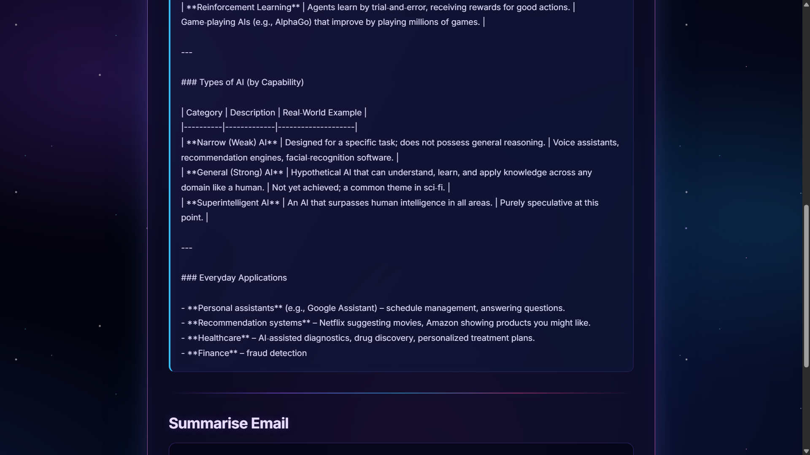

It also handles generative tasks, such as drafting a sample email:

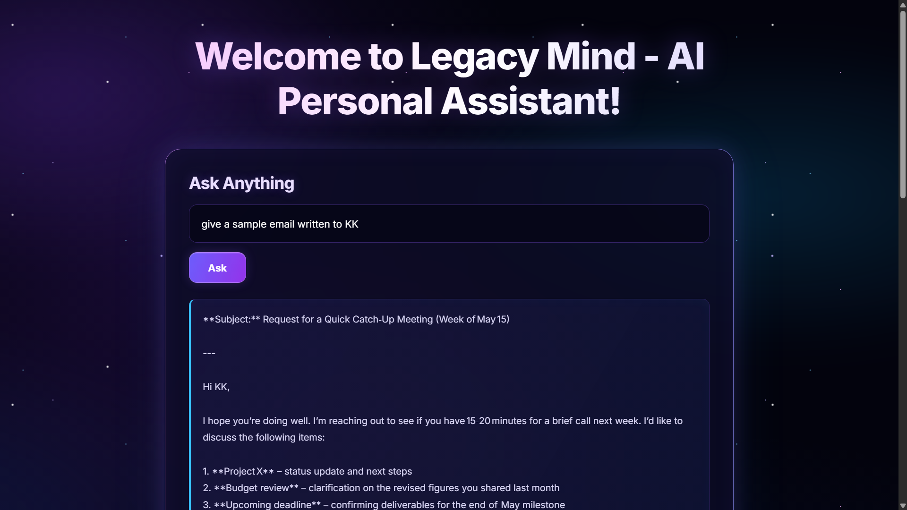

### Summarise Email

Paste an email and get a 2–3 sentence summary that keeps the dates, decisions and action items:

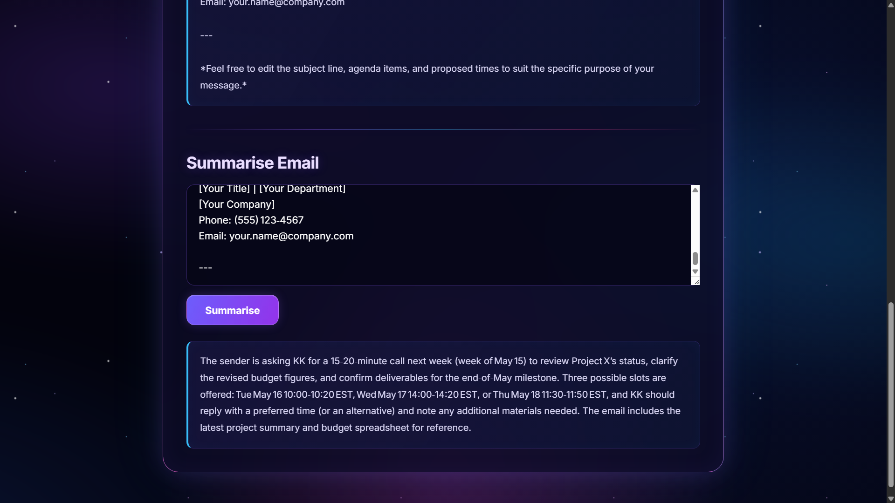

> *The model replies in Markdown (`**bold**`, `###` headings, tables), which the page currently shows as plain text because output is written with `innerText` for XSS safety. Safe Markdown rendering is listed in the Roadmap section below.*

---

## Problem Statement

Everyday assistant tasks — a quick factual question, or condensing a long email into the dates, decisions and action items that matter — normally mean switching between a chat app and a mail client, or pasting text into a general-purpose chatbot with no consistent behaviour.

## Solution Overview

Legacy Mind is a deliberately small web app that exposes two purpose-built endpoints behind one page:

- **Ask Anything** — a single-turn Q&A with a "helpful personal assistant" system prompt.
- **Summarise Email** — a task-specific prompt that forces a 2–3 sentence summary preserving dates, decisions, action items and deadlines, at a lower temperature for consistency.

The browser never sees the API key. All model calls are made server-side by Flask using the Groq Python SDK.

> *Project history: this app was forked from [shradha-khapra/AI_Assistant_withFlask](https://github.com/shradha-khapra/AI_Assistant_withFlask) and its inference backend was swapped to Groq while keeping the UI intact.*

---

## Key Features

| Feature | Description | Where |
|---|---|---|
| Ask Anything | Single-turn Q&A, temperature 0.7, up to 512 output tokens | `main.py` → `ask()` |
| Summarise Email | 2–3 sentence summary preserving dates, decisions, actions, deadlines; temperature 0.3 | `main.py` → `summarize()` |
| Async UI | `fetch` + `FormData`; page never reloads; loading indicator per tool | `templates/index.html` |
| Safe rendering | Model output written with `innerText`, never `innerHTML` | `templates/index.html` |
| Secret hygiene | API key loaded from `.env`, which is git-ignored | `main.py`, `.gitignore` |
| Fail-fast config | App refuses to boot if `GROQ_API_KEY` is missing | `main.py` (module level) |
| Themed UI | Animated nebula, twinkling stars, neon buttons, responsive, reduced-motion support | `static/style.css` |

---

## Overall Architecture

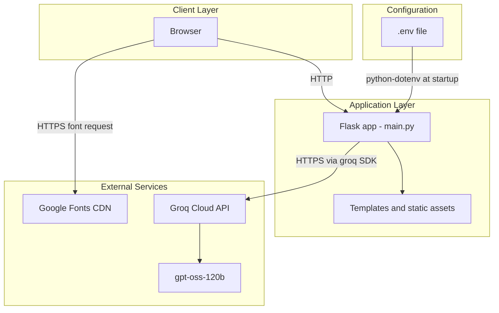

## System Architecture

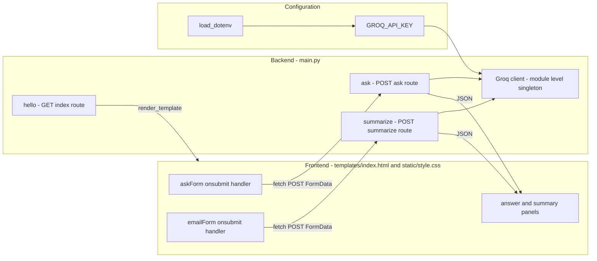

---

## Technology Stack — Complete Breakdown

> Every package found in the project's virtual environment, plus the external services it talks to. Direct dependencies are pinned in `requirements.txt`; versions below are read from the installed `.venv` dist-info.

### Direct dependencies (imported by `main.py`)

| Technology / Package | Version | Category | Purpose in Project | Why Chosen | Key Features Used |
|---|---|---|---|---|---|
| Flask | 3.1.3 | Web framework | Serves the page and the two JSON endpoints | Minimal, no boilerplate, ideal for a three-route app | `Flask()`, `@app.route`, `render_template`, `request.form`, `jsonify`, `app.logger`, debug server and reloader |
| groq | 1.7.0 | LLM SDK | Calls Groq's OpenAI-compatible chat completions API | Official SDK, very low-latency inference, near drop-in shape for OpenAI-style code | `Groq(api_key=...)`, `client.chat.completions.create(model, messages, temperature, max_completion_tokens)` |
| python-dotenv | 1.2.4 | Configuration | Loads `GROQ_API_KEY` from `.env` into `os.environ` | Keeps secrets out of source (12-factor config) | `load_dotenv()` — searches upward from `main.py`'s directory; does **not** override variables already set in the OS environment |

### Transitive dependencies (installed automatically)

| Package | Version | Category | Role in this project |
|---|---|---|---|
| Werkzeug | 3.1.9 | WSGI toolkit | Dev server, request/response objects, interactive debugger and reloader behind `debug=True` |
| Jinja2 | 3.1.6 | Templating | Renders `index.html`, resolves `url_for('static', ...)` |
| MarkupSafe | 3.0.4 | Templating | Escaping used by Jinja2 |
| itsdangerous | 2.2.0 | Security helper | Flask dependency for signing; not used by app code (no sessions) |
| click | 8.5.0 | CLI | Powers the `flask` command (`flask run`) |
| blinker | 1.9.0 | Signals | Flask's signal dispatch; not used directly |
| httpx | 0.28.1 | HTTP client | Transport the Groq SDK uses to reach `api.groq.com` |
| pydantic | 2.14.1 | Validation | Typed response models returned by the Groq SDK |

### Frontend and platform (no package manager)

| Technology | Category | Purpose | Notes |
|---|---|---|---|
| Vanilla JavaScript | Frontend | `fetch`, `FormData`, `async/await`, DOM updates | No framework, no build step |
| CSS3 | Styling | Glassmorphism card, galaxy background, keyframe animations, `@media (max-width: 600px)`, `prefers-reduced-motion` | 14 documented sections in `static/style.css` |
| Inter (Google Fonts) | Typography | UI font loaded via `@import` in `style.css` | The only runtime CDN dependency in the browser |
| Python | Runtime | 3.14.6 (venv created with **uv** 0.11.23) | From `.venv/pyvenv.cfg` |
| GPT-OSS 120B | Model | Hosted inference for both tools | Model id `openai/gpt-oss-120b` (Groq production tier; replaced the retired `llama-3.3-70b-versatile`) |

---

## Request Lifecycle

### 1. Read — loading the page (`GET /`)

```
1. BROWSER
   └── User opens http://localhost:5000/

2. FLASK DEV SERVER (Werkzeug)
   └── Routes the request by URL map → view function hello() in main.py
       (no custom middleware is registered; only Flask defaults)

3. VIEW FUNCTION
   └── hello() → render_template("index.html")
       → Jinja2 resolves {{ url_for('static', filename='style.css') }} → /static/style.css

4. RESPONSE
   └── 200 text/html

5. BROWSER FOLLOW-UP REQUESTS
   └── GET /static/style.css            → served by Flask's built-in static route
       GET fonts.googleapis.com (Inter) → @import inside style.css
   └── Inline <script> at the bottom of <body> binds onsubmit handlers
       to #askForm and #emailForm
```

### 2. Write — asking a question (`POST /ask`)

```
1. USER INTERACTION
   └── Types a question in #questionInput → presses Ask
       → HTML5 `required` blocks an empty submit before JavaScript even runs

2. FRONTEND HANDLER  (templates/index.html → askForm.onsubmit)
   └── e.preventDefault()          ← stops the native GET submit
       new FormData(e.target)      ← { question: "..." }
       shows #ans-loading, clears #answer
       fetch("/ask", { method: "POST", body: formData })

3. FLASK ROUTING
   └── POST /ask → ask() in main.py

4. VALIDATION
   └── question = request.form.get("question", "").strip()
       empty → 400 {"error": "Please enter a question."}

5. MODEL CALL  (still inside ask())
   └── client.chat.completions.create(
           model="openai/gpt-oss-120b",
           messages=[ system: "Act like a helpful personal assistant.",
                      user:   <question> ],
           temperature=0.7, max_completion_tokens=512)
       → groq SDK → httpx → HTTPS → api.groq.com

6. INFERENCE (hosted, not local)
   └── Groq runs the prompt through GPT-OSS 120B
       → returns choices[0].message.content

7. RESPONSE ASSEMBLY
   └── answer = response.choices[0].message.content
       return jsonify({"response": answer}), 200

8. FRONTEND RENDER
   └── res.ok → answer.innerText = data.response   (textContent-style, XSS-safe)
       finally → hide #ans-loading

ERROR PATH
   └── Any exception in step 5 (bad key, rate limit, network, bad model)
       → caught by `except Exception`
       → app.logger.exception(...) writes the FULL traceback to the terminal
       → client receives 500 {"error": "Unable to generate an answer. Please try again."}
       → frontend: !res.ok → throw Error(data.error) → shown in #answer
```

### 3. Write — summarising an email (`POST /summarize`)

Identical to `/ask` with these differences: form field `email`, handler `summarize()`, system prompt *"You are an expert email assistant. Summarize emails in 2-3 sentences. Preserve important dates, decisions, action items, and deadlines."*, `temperature=0.3`, loading element `#summary-loading`, output element `#summary`, and error text *"Unable to summarize the email. Please try again."*

---

## Data Flow

### Component interaction

```
User input → <form> → onsubmit handler → FormData → fetch POST
  → Flask route (ask or summarize) → strip + validate
  → Groq SDK client → api.groq.com → GPT-OSS 120B
  → response.choices[0].message.content → jsonify
  → fetch response → res.json() → element.innerText
```

### State management

There is **no application state** — no database, session, cache or conversation memory. Each request is a single, independent turn; the model never sees earlier questions. The only "state" is DOM text in `#answer` and `#summary`, plus the one module-level Groq client created at import time.

### Configuration flow (startup)

```
flask run  →  imports main.py
  → load_dotenv() reads .env  (parse errors are only WARNINGS and the line is skipped)
  → os.getenv("GROQ_API_KEY")
  → falsy?  raise ValueError(...)  ← app fails to import, Flask shows the debugger page
  → truthy → Groq(api_key=...) → app starts
```

### Data transformations

| Layer | Input | Transformation | Output |
|---|---|---|---|
| Browser | Text in input or textarea | `FormData` encoding (multipart/form-data) | POST body |
| Flask | Form field | `.strip()` | Clean string or 400 |
| Prompt builder | String | Wrapped in a `messages` array with a task-specific system prompt | Chat payload |
| Groq SDK | Python dict | httpx JSON request, pydantic response parsing | `ChatCompletion` object |
| Flask | `ChatCompletion` | Extract `choices[0].message.content` | `{"response": "..."}` |
| Browser | JSON | `res.json()` → `innerText` | Visible text, never parsed as HTML |

### Error propagation

```
Groq/network exception → except Exception in ask() or summarize()
  → logged with traceback (terminal only)  → generic message to client (HTTP 500)
  → fetch handler throws → caught → message written into the panel
```

> The detail is intentionally hidden from the UI, which is good for safety but means **the browser can never tell you why a call failed — read the terminal.** See [Troubleshooting](#troubleshooting--why-it-happens).

---

<details>
<summary> UML Diagrams — Full Suite (9 Diagrams + Swimlane)</summary>

### UML 1 — Use Case Diagram

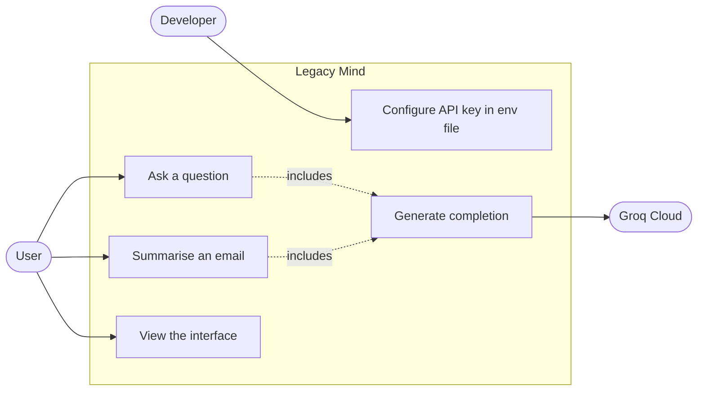

### UML 2 — Class Diagram

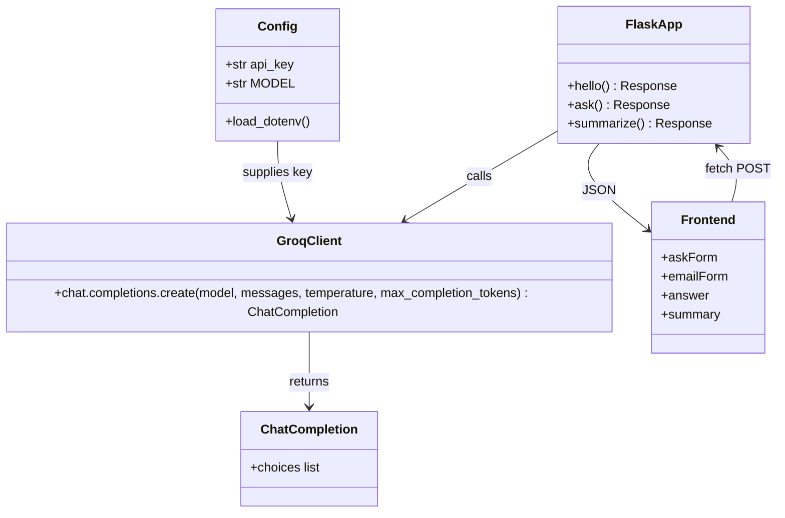

### UML 3 — Sequence Diagram

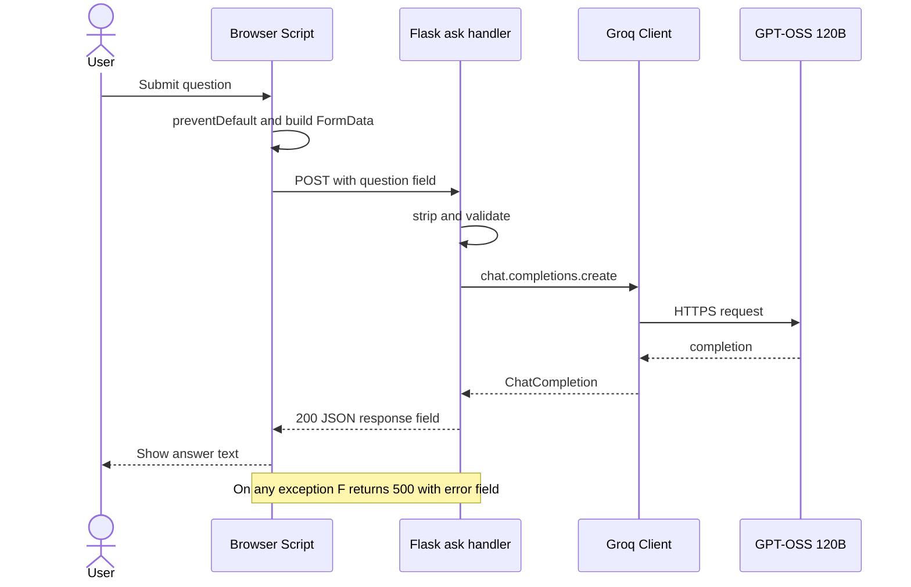

### UML 4 — Collaboration Diagram

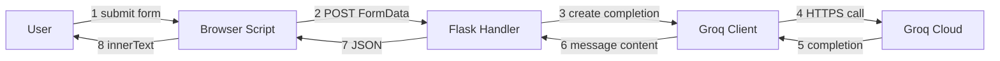

### UML 5 — Activity Diagram

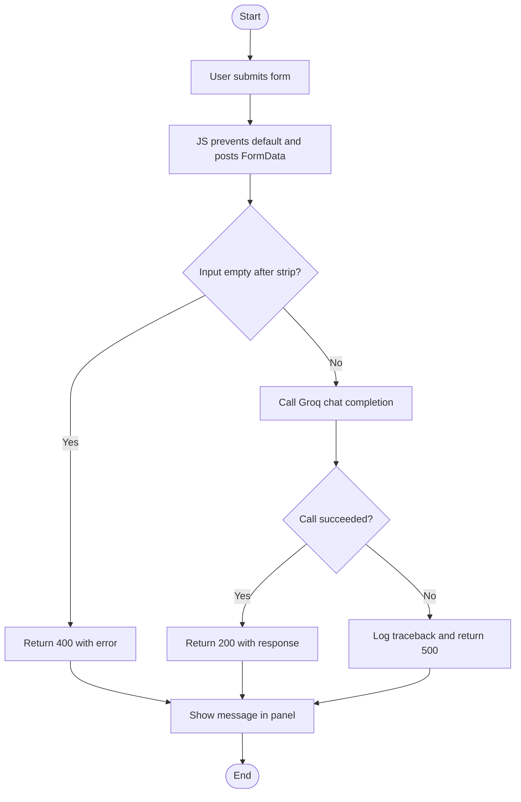

### UML 6 — State Diagram (answer panel)

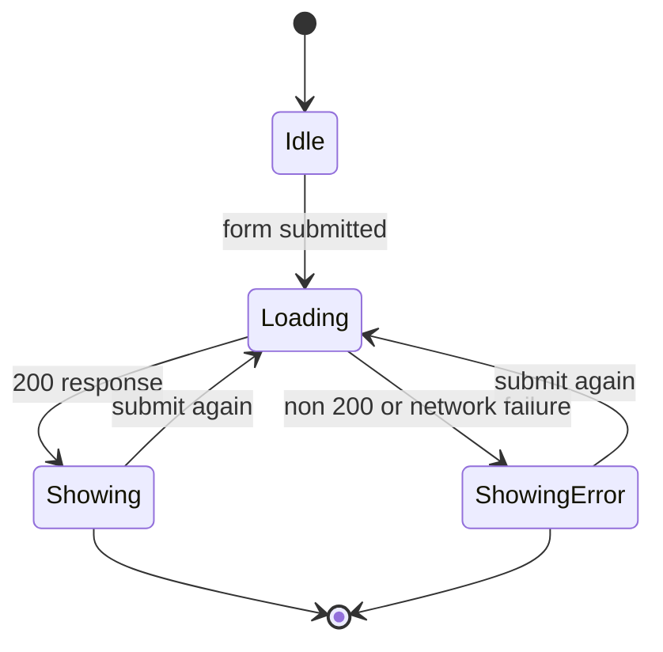

### UML 7 — Component Diagram

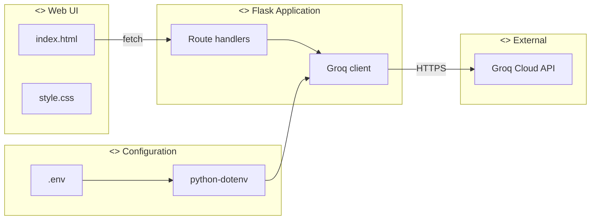

### UML 8 — Deployment Diagram

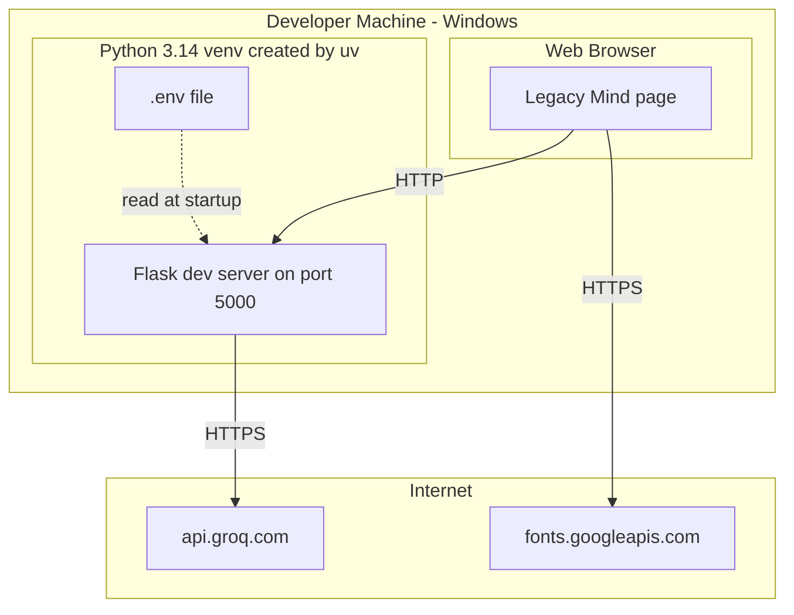

### UML 9 — Package Diagram

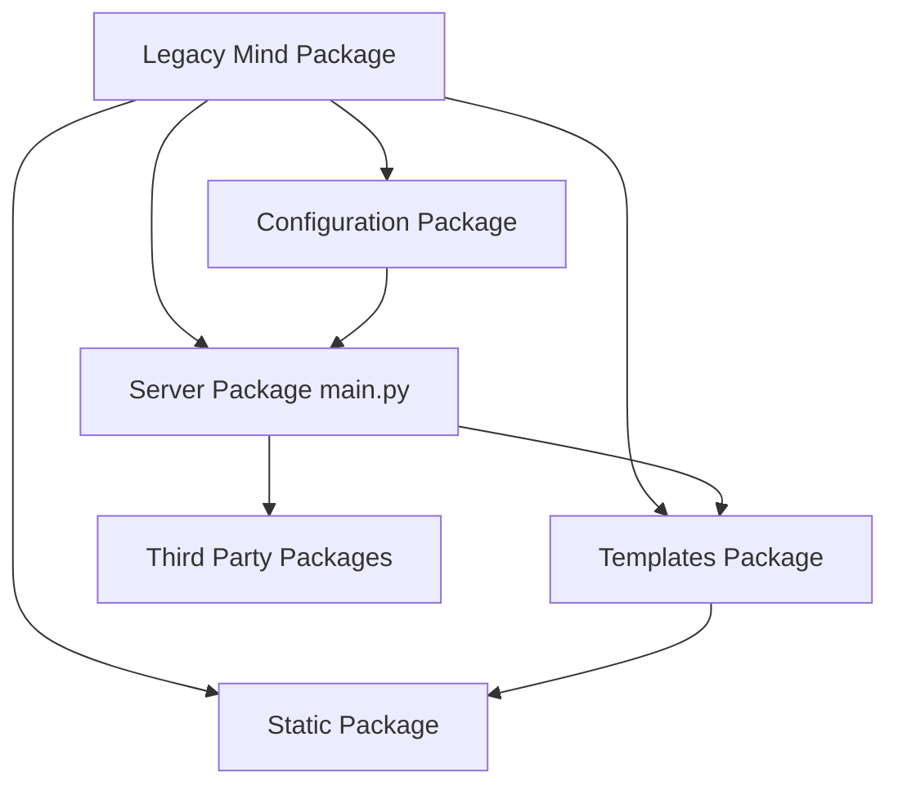

### Swimlane Diagram

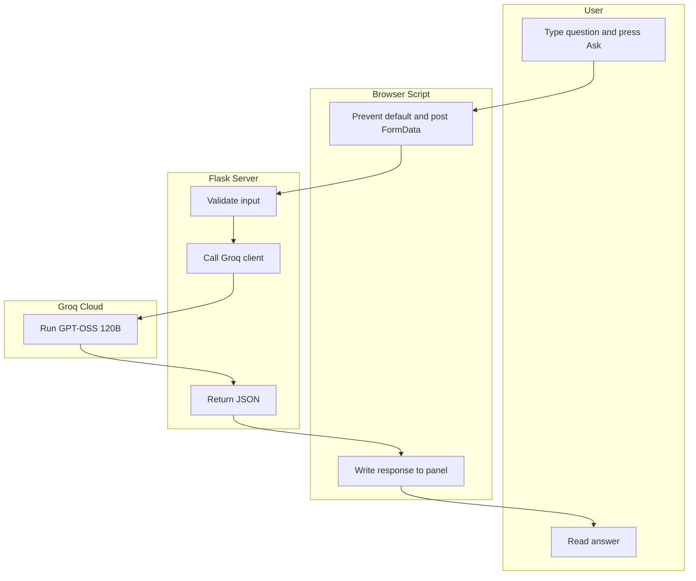

</details>

<details>
<summary> Data Flow Diagrams (L0 + L1)</summary>

### DFD Level 0 — Context

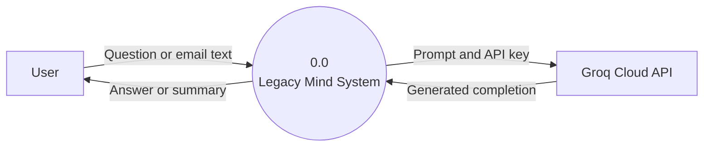

### DFD Level 1 — System

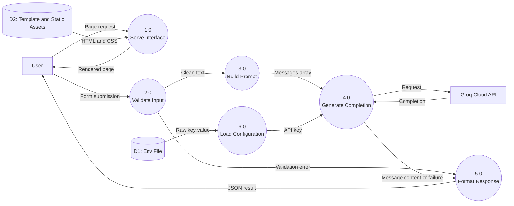

</details>

---

## Folder Structure

```
legacy-mind/
├── main.py              # Entire backend: config load, Groq client, 3 routes
├── templates/
│   └── index.html       # Single page: two forms + inline fetch scripts
├── static/
│   └── style.css        # 14-section theme: galaxy bg, glass card, neon buttons, responsive
├── docs/
│   └── images/          # README screenshots
├── .env                 # GROQ_API_KEY (git-ignored — never commit)
├── .gitignore           # Ignores .env, .venv/, __pycache__/, *.pyc
├── requirements.txt     # Pinned: Flask, groq, python-dotenv
├── .venv/               # uv-managed virtualenv (Python 3.14.6)
└── __pycache__/         # Bytecode cache
```

---

## Prerequisites

- Python 3.10+ (developed on 3.14.6)
- A free API key from [console.groq.com](https://console.groq.com) → **API Keys**
- Git (only if you are cloning)

## Installation Guide

```bash
# 1. Clone (or add as a submodule, see below)
git clone https://github.com/KARTHIKAKRISHNA123/legacy-mind.git
cd legacy-mind

# 2. Create and activate a virtual environment
python -m venv .venv                 # or: uv venv
source .venv/Scripts/activate        # Git Bash on Windows
# .venv\Scripts\Activate.ps1         # PowerShell

# 3. Install dependencies
pip install -r requirements.txt      # or: uv pip install -r requirements.txt

# 4. Create .env  (see next section for the exact format)
echo 'GROQ_API_KEY=your_key_here' > .env

# 5. Run
flask --app main run                 # or: python main.py
```

Open **http://localhost:5000**.

## Environment Variables

| Variable | Required | Example | Description |
|---|---|---|---|
| `GROQ_API_KEY` |  | `gsk_xxxxxxxx...` (56 characters) | Groq API key. Missing or unparseable → app raises `ValueError` at import and will not start. |

**`.env` format rules** — this file is parsed by python-dotenv, not a shell:

```ini
# valid
GROQ_API_KEY=gsk_your_key_here
GROQ_API_KEY="gsk_your_key_here"

# invalid — anything after the closing quote makes the whole line unparseable
GROQ_API_KEY="gsk_your_key_here"oops
```

## Configuration Guide

Tunable constants live directly in `main.py`:

| Setting | Location | Current value | Effect |
|---|---|---|---|
| `MODEL` | module level | `openai/gpt-oss-120b` | Which Groq-hosted model answers |
| `temperature` | `ask()` | `0.7` | Creativity of answers |
| `temperature` | `summarize()` | `0.3` | More deterministic summaries |
| `max_completion_tokens` | both | `512` | Hard cap on output length |
| System prompts | both | see Request Lifecycle | Behaviour of each tool |
| `app.run(debug=True)` | bottom of `main.py` | `True` | Reloader + interactive debugger (dev only) |

---

## API Documentation

Both POST endpoints accept **form data** (`multipart/form-data` from `FormData`, or `application/x-www-form-urlencoded`), not JSON.

| Method | Path | Form field | Success | Errors |
|---|---|---|---|---|
| `GET` | `/` | — | `200` HTML page | — |
| `POST` | `/ask` | `question` | `200 {"response": "<text>"}` | `400 {"error": "Please enter a question."}` · `500 {"error": "Unable to generate an answer. Please try again."}` |
| `POST` | `/summarize` | `email` | `200 {"response": "<text>"}` | `400 {"error": "Please enter email content."}` · `500 {"error": "Unable to summarize the email. Please try again."}` |

```bash
curl -X POST http://localhost:5000/ask -F "question=What is machine learning?"
curl -X POST http://localhost:5000/summarize -F "email=Hi team, the review moves to Friday 3pm. Please send slides by Thursday."
```

> `GET /ask?question=...` returns **405 Method Not Allowed** — only POST is registered.

## Database Schema Overview

None. The app is stateless and persists nothing.

## Authentication Flow

There is **no user authentication**. The only credential is the server-side Groq API key.

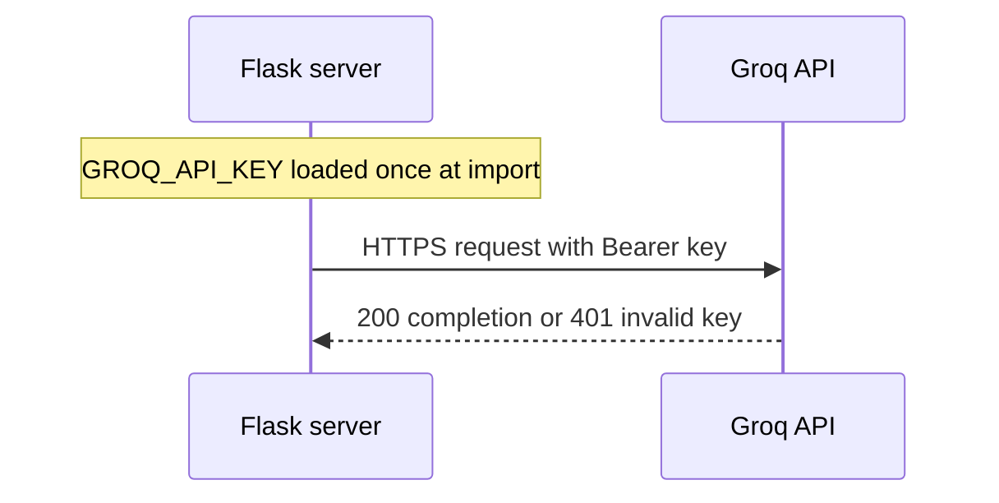

> A `401` from Groq surfaces to the user only as the generic *"Unable to generate an answer"* message — the exact reason is in the terminal.

## Backend Architecture

A flat single-module Flask app: configuration and client construction at import time, then three view functions. There is no blueprint, service layer or ORM — appropriate at this size. The Groq client is created **once** at module level, so its underlying httpx connection pool is reused across requests.

## Frontend Architecture

Server-rendered template plus ~80 lines of vanilla JS. Two independent forms (`#askForm`, `#emailForm`) each get an `onsubmit` handler that calls `preventDefault()`, posts `FormData` with `fetch`, toggles a loading element, and writes the result with `innerText`. No bundler, framework or state library.

---

## Security Considerations

| Area | Current state | Risk / note |
|---|---|---|
| API key storage | `.env`, git-ignored | OK: never sent to the browser |
| Output rendering | `innerText` | OK: model output cannot inject HTML or script |
| Endpoint access control | None | Risk: Anyone who can reach the server can spend your Groq quota |
| Rate limiting | None | Risk: Add Flask-Limiter before exposing publicly |
| Input size limit | None | Risk: A very large email can exceed the model's context or burn tokens; set `MAX_CONTENT_LENGTH` |
| `debug=True` | Enabled | Risk: Werkzeug debugger allows code execution — **never** expose it beyond localhost |
| Prompt injection | Summariser processes untrusted email text | Low impact (no tools or data access), but a malicious email can bend the summary |
| `.gitignore` | Ignores `.env`, `.venv/`, `__pycache__/`, `*.pyc` | OK: secrets and the virtualenv stay out of git |

## Performance, Scalability and Operations

- **Latency** is dominated by the Groq call; the app does no other heavy work.
- **Output cap** of 512 tokens bounds both latency and cost.
- **Blocking**: the dev server handles requests synchronously per worker thread; use a production WSGI server for concurrency.
- **Scalability**: fully stateless, so it scales horizontally behind a load balancer with the same env var on each instance. No sticky sessions, cache or shared storage needed.
- **Logging**: `app.logger.exception(...)` on both failure paths writes full tracebacks to stderr. No structured logging or log file.
- **Testing**: no automated tests exist.
- **Docker / CI/CD**: no `Dockerfile` or pipeline config present.

## Deployment Guide

**Local (supported):** see [Installation Guide](#installation-guide).

**Cloud (not yet configured in this repo):** any Python host works (Render, Railway, Fly.io, etc.). You would need to (1) run under a production server such as `gunicorn main:app` instead of `app.run(debug=True)`, and (2) set `GROQ_API_KEY` in the platform's environment settings rather than a committed file.

### As a git submodule (AIML Knowledge Base)

```bash
cd /d/AIML
git submodule add https://github.com/KARTHIKAKRISHNA123/legacy-mind.git projects/legacy-mind
git submodule status          # no "-" prefix = healthy
```

---

## Troubleshooting — Why It Happens

### 1. `ValueError: GROQ_API_KEY is missing from the .env file`

**What you see:** the Werkzeug debugger page right after `flask run`, with the traceback ending at `main.py`, line 15.

**Why it happens — the chain of events:**

1. `main.py` runs `load_dotenv()` and `os.getenv("GROQ_API_KEY")` **at import time** — before any route exists.
2. If `getenv` returns nothing, the module deliberately raises `ValueError` (fail-fast), so Flask cannot even load the app and shows the error instead of the site.
3. The reason `getenv` returned nothing is almost always that **python-dotenv could not parse the line**. It does not crash on a bad line; it logs a *warning* — `python-dotenv could not parse statement starting at line 1` — and **skips it**. That warning is easy to miss above the traceback.
4. The most common cause is stray text after a closing quote, for example `GROQ_API_KEY="gsk_..."tou`. The quoted value ends at the second `"`, and the leftover characters make the statement invalid.

**Other causes of the same error**

| Cause | Check |
|---|---|
| Wrong variable name (`GROK_API_KEY`, `GROQ_KEY`, trailing space in the name) | The name must be exactly `GROQ_API_KEY` |
| `.env` saved as `.env.txt` | File Explorer → show extensions |
| `.env` in the wrong folder | Must sit next to `main.py` (or in a parent folder) |
| Server not restarted | `.env` is read once at startup; the reloader only watches `.py` files |
| OS variable already set to an empty or old value | `load_dotenv()` does **not** override existing env vars. In PowerShell: `echo $env:GROQ_API_KEY`, then `Remove-Item Env:GROQ_API_KEY`, or use `load_dotenv(override=True)` |

**Fix:** make the line `GROQ_API_KEY=gsk_your_key_here` (quotes optional, nothing after them), save, and restart the server.

---

### 2. The page loads but shows *"Unable to generate an answer. Please try again."*

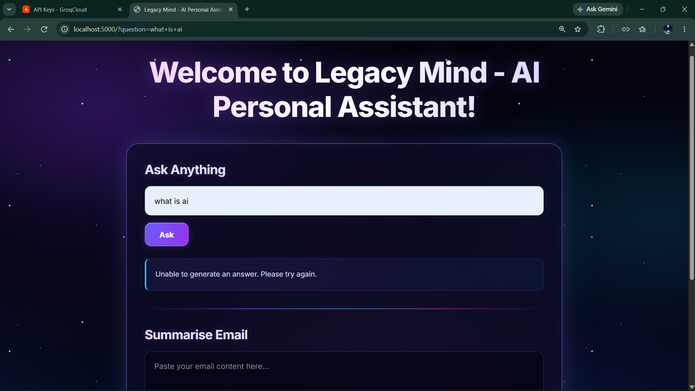

**Why it happens:** the key was found, so the app booted — but the call to Groq itself raised an exception. `ask()` wraps the call in a broad `except Exception`, logs the traceback, and returns a deliberately generic `500` so no internal detail leaks to the browser. The message in the screenshot is that generic text, written into `#answer` by the frontend.

**The real reason is only in the terminal** where Flask is running — look for `Error while processing the question` followed by a traceback. The last line tells you which case you are in:

| Last line of the traceback | Meaning | Fix |
|---|---|---|
| `AuthenticationError` / `401` / *Invalid API Key* | Key is wrong, revoked, truncated, or you edited `.env` without restarting | Regenerate at console.groq.com → API Keys, paste into `.env`, **restart Flask** |
| `NotFoundError` / `model_decommissioned` / `model_not_found` | Model id was retired, misspelt, or not available to your tier | Check [console.groq.com/docs/deprecations](https://console.groq.com/docs/deprecations), pick a current id from the models page, update `MODEL` |
| `RateLimitError` / `429` | Free-tier request or token limit hit | Wait and retry, or reduce usage |
| `APIConnectionError` / timeout | No internet, proxy or firewall blocking `api.groq.com` | Check connectivity / proxy settings |
| `BadRequestError` / `400` | Payload rejected (for example input too large) | Shorten the input |

**Real case from this project:** the log ended with `groq.NotFoundError: Error code: 404 ... The model llama-3.3-70b-versatile does not exist or you do not have access to it ... model_not_found`. The API key was fine (a bad key returns 401). Groq [retired `llama-3.3-70b-versatile` on 16 Aug 2026](https://console.groq.com/docs/deprecations) for free and developer-tier accounts and recommends `openai/gpt-oss-120b` as its replacement, so the model id in `main.py` was updated. Lesson: model ids are not permanent — a working app can start failing without any code change.

> `openai/gpt-oss-120b` is a reasoning model, so part of `max_completion_tokens` can be spent on internal reasoning. If long answers look cut off, raise `max_completion_tokens` (for example to 1024).

---

### 3. The address bar shows `/?question=what+is+ai`

**Why it happens:** the `<form id="askForm">` has no `action` or `method`, so a *native* submit is an HTTP **GET to the current URL** with the field appended as `?question=...`. The handler that prevents this (`e.preventDefault()`) is bound by the inline script at the bottom of the page. A native submit therefore happens when that script did not run for that submission — a stale cached copy of an older page, a JavaScript error, or pressing Enter before the page finished loading. Route `/` ignores query strings, so nothing is answered; the URL just stays in the address bar and the browser may restore the typed text.

**In the screenshot**, the error text itself can only come from the `fetch` path, so JavaScript did run on at least that submission; the `?question=` URL most likely survived from an earlier native submit.

**Fix:** hard-refresh (**Ctrl + Shift + R**) on plain `http://localhost:5000/`, then submit again. Treat the visible message as symptom #2 above.

---

## Engineering Decisions and Tradeoffs

| Decision | Why | Tradeoff |
|---|---|---|
| Fail-fast on missing key at import | Misconfiguration is caught immediately, not on the first user request | A bad `.env` takes down the whole app, including the static page |
| Generic 500 message, detailed server log | Prevents leaking internals (keys, stack traces) to clients | Browser can't diagnose failures; developers must read the terminal |
| Form data instead of JSON | Works directly with `FormData` and plain `curl -F`; minimal JS | Less conventional for APIs than JSON |
| `innerText` for output | Eliminates XSS from model output | Markdown replies show as raw text (visible in the Demo screenshots) |
| Two endpoints, two system prompts | Task-specific behaviour and temperature per tool | Prompt logic is duplicated in two handlers |
| Single-turn requests | Simple, stateless, horizontally scalable | No conversation memory |
| Groq-hosted open model over a local model | Very fast inference, no GPU needed | Needs internet and an API key; subject to rate limits |

## Roadmap (suggested)

- [x] `requirements.txt` with pinned versions
- [x] Complete `.gitignore` (`.venv/`, `__pycache__/`)
- [ ] Return the exception *type* (not message) in the 500 JSON for easier diagnosis
- [ ] Conversation history for Ask Anything
- [ ] Streaming responses
- [ ] Render Markdown answers safely (for example `marked` + `DOMPurify`) instead of showing raw `**` and `###`
- [ ] Rate limiting and `MAX_CONTENT_LENGTH`
- [ ] Production server config (`gunicorn`), Dockerfile, health-check route
- [ ] Basic tests with Flask's test client and a mocked Groq client

## FAQ

**Is this Grok or Groq?** Groq (groq.com) — an inference provider that hosts open models such as Llama and GPT-OSS. Grok is xAI's separate model and API; this project does not use it.

**Does it remember previous questions?** No. Every request is independent.

**Where is my data stored?** Nowhere in this app. Prompts are sent to Groq for processing under Groq's own terms.

**Can I change the model?** Yes — edit `MODEL` in `main.py` to any chat model id available on your Groq account.

## Contributing

1. Fork and create a branch: `git checkout -b feature/your-change`
2. Keep secrets out of commits — confirm `.env` is ignored
3. Run the app locally and exercise both tools before opening a pull request

## License

No license file is present in this repository. Add one (for example MIT) before accepting contributions or redistributing.
